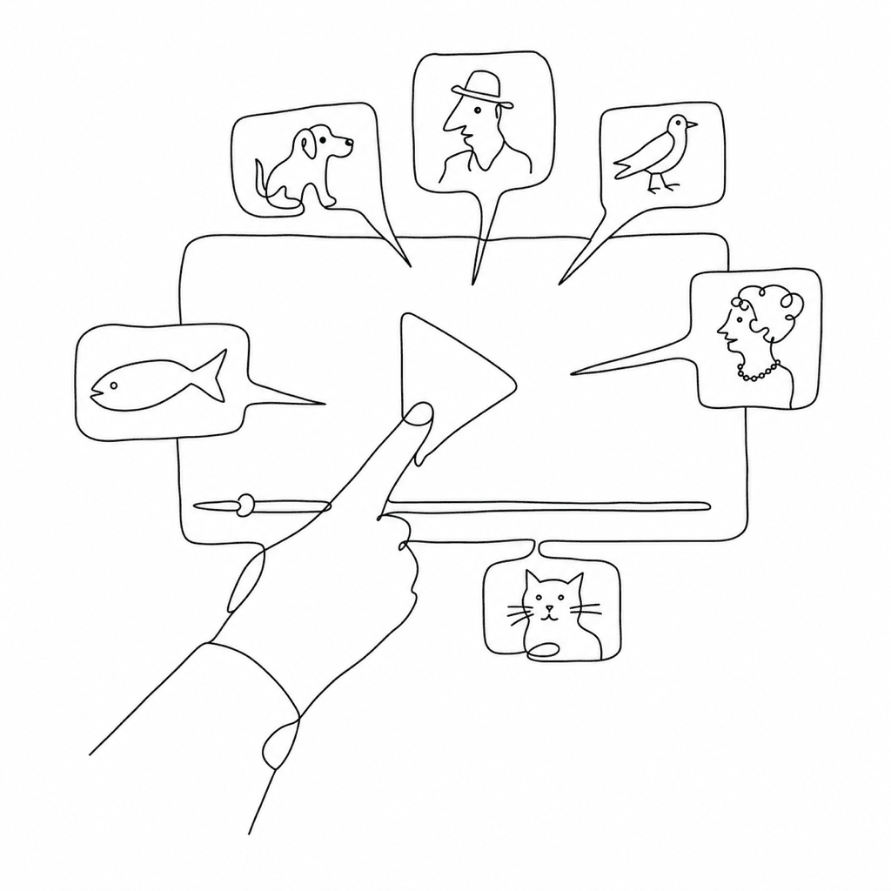

<!-- this_file: README.md -->

# vexy-vlip-js

Turn a single video + WebVTT file into a click-to-advance explainer with styled, positioned on-screen cards — zero runtime dependencies.



## What it is

Vexy Vlip reads a WebVTT track alongside a `<video>` and renders each cue as a real HTML card: arbitrary background, padding, radius, shadow, and pixel-perfect placement — things the browser's `::cue` pseudo-element cannot provide. Two playback modes:

- **Continuous** — normal playback; cards appear and disappear with their cue timings.
- **Stepped** — plays to each cue's start time, pauses, shows the card; the viewer clicks (or presses Space) to advance. Like a narrated slideshow that still looks like a video.

Optional eased segment travel (`ease-in-out`, etc.) drives `currentTime` on a `requestAnimationFrame` loop for cinematic scrubbing. All cards are real DOM — focusable, localizable, responsive.

## Install

```bash
npm i vexy-vlip-js
```

## Usage

Three ways to drop a player on a page, easiest first.

### Web Component

```html
<!-- auto-registers <vexy-vlip> as a side effect -->
<script type="module" src="./dist/vexy-vlip.element.js"></script>

<vexy-vlip
  src="demo.mp4"
  track="demo.vtt"
  mode="stepped"
  controls>
</vexy-vlip>
```

Boolean attributes follow HTML semantics — presence means `true`. Attributes are reactive: changing `mode` or `easing` on the element updates the live player. Import `vexy-vlip-js/element` in a module context to auto-register without a bundled file.

### ES Module

```js
import { VexyVlip } from "vexy-vlip-js";

const vlip = new VexyVlip(document.querySelector("#stage"), {
  src: "demo.mp4",
  track: "demo.vtt",
  mode: "stepped",   // "continuous" | "stepped"  (default: "continuous")
  controls: true,
});

// Methods are available immediately; track loading is async internally.
document.querySelector("#next").addEventListener("click", () => vlip.next());

// Events bubble on the container element.
document.querySelector("#stage").addEventListener("vexyvlip:stop", (e) => {
  console.log("paused at segment", e.detail.index);
});
```

### Classic script global

```html
<script src="./dist/vexy-vlip.global.js"></script>
<script>
  // window.VexyVlip is the class; <vexy-vlip> is also auto-registered.
  const vlip = new VexyVlip(document.querySelector("#stage"), {
    src: "demo.mp4",
    track: "demo.vtt",
    mode: "continuous",
  });
</script>
```

## Use from a CDN (no install, no build)

Load the player straight from a `<script>`/`import`, no npm install. Pin a version so a new release never breaks your page (`@1.0.0` = exact, `@1` = latest 1.x, omit = latest):

```html
<!-- Web Component: auto-registers <vexy-vlip> -->
<script type="module"
  src="https://cdn.jsdelivr.net/npm/vexy-vlip-js@1/dist/vexy-vlip.element.js"></script>
<vexy-vlip src="demo.mp4" track="demo.vtt" mode="stepped" controls></vexy-vlip>
```

```html
<!-- Classic global: window.VexyVlip + <vexy-vlip>. The bare URL resolves to
     the global build via the package's "jsdelivr" field. -->
<script src="https://cdn.jsdelivr.net/npm/vexy-vlip-js@1"></script>
```

For the ESM API from the CDN, import from `…/vexy-vlip-js@1/src/index.js` (or the auto-bundled `…/vexy-vlip-js@1/+esm`). unpkg works with the same paths. Use **JSDelivr** for production — it is version-pinnable, immutable, and globally cached from the published npm release. The unversioned **vexy.dev** bundles (`https://vexy.dev/vexy-vlip-js/vexy-vlip.element.js`) always track the latest deployed site, so they suit demos, not production embeds.

## Cue / card authoring

The `.vtt` file is both the timing script and the layout spec for each card. Author placement in pure WebVTT cue settings, and reach for a JSON payload only when you need per-cue styling or trusted HTML.

### Plain text + WebVTT cue settings

```webvtt
WEBVTT

00:02.000 --> 00:05.000 position:70%,line-right line:24%,start size:38%
Click the **Export** button in the toolbar.
```

Supported cue settings (all percentages):

| Setting | Effect |
| --- | --- |
| `position:N%[,line-left\|center\|line-right]` | Horizontal pin (% of width); the optional **position-align** picks the box edge/centre pinned there |
| `line:N%[,start\|center\|end]` | Vertical pin (% of height); the optional **line-align** picks the edge (`start`=top, `end`=bottom) |
| `size:N%` | Card width as % of video width |
| `align:start\|center\|end` | Text alignment (also the default position-align when that's omitted) |

`position-align` × `line-align` resolve to the nine-point anchor — e.g. `line-right` + `end` = `bottom-right`, `center` + `start` = `top`. With no `line`, the card sits at the bottom. So everything the JSON `anchor` does is expressible in pure WebVTT (this is how `testdata/playlines.vtt` is authored — no JSON).

Inline markdown subset: `**bold**`, `*italic*`, `` `code` ``, line breaks. No raw HTML (XSS-safe).

### JSON payload

A cue whose trimmed payload starts with `{` is parsed as a JSON card — for per-cue styling and trusted `html`. All fields are optional except one of `text` or `html`; a parse failure falls back to plain text (no silent blank cards).

```webvtt
00:05.000 --> 00:08.000
{ "text": "Drag the slider to fan the cards out.",
  "x": 8, "y": 62, "w": 36, "anchor": "top-left",
  "bg": "#10243a", "fg": "#eaf2ff", "radius": 14, "padding": "14px 18px",
  "shadow": "0 8px 30px rgba(0,0,0,.45)", "class": "tip" }
```

When `x`/`y`/`w` are absent, placement falls back to the cue's native `position`/`line`/`size`, then to the player default (bottom-center, `y: 86%`). The full JSON field list, every option, and all theming variables live in **[docs/reference.md](docs/reference.md)**.

> **Security note.** Plain-text and JSON `text` cards are always HTML-escaped. A JSON `html` card is inserted as-is; `sanitize: true` is a convenience filter (strips `<script>`/`on*`/`javascript:`), **not** a hardened sanitizer. Treat the WebVTT file as trusted, author-controlled content; for untrusted input, sanitize upstream with a vetted library such as DOMPurify.

## Methods

| Method | Description |
| --- | --- |
| `play()` | Play. In stepped mode, advances to the next stop point. |
| `pause()` | Pause and cancel any eased travel. |
| `toggle()` | Play/pause toggle (stepped: advance or pause mid-travel). |
| `next()` | Jump to the next segment. |
| `prev()` | Jump to the previous segment. |
| `close()` | Dismiss the cards: switch to continuous mode and resume playback (no-op in continuous). |
| `replay()` | Restart playback from the beginning (same as the Replay CTA). |
| `seekTo(time)` | Seek to an absolute time in seconds. |
| `goToSegment(i)` | Seek to segment `i` and show its card. |
| `setMode(mode)` | Switch `"continuous"` / `"stepped"` live. |
| `setEasing(easing)` | Change easing live. |
| `showCard(i)` / `hideCard()` | Manual card control. |
| `getSegments()` | Parsed segment array (read-only copy). |
| `destroy()` | Remove DOM, listeners, and frame-callback handles. |

**Getters:** `segments`, `currentSegment`, `currentTime`, `duration`, `mode`, `playing`, `ready`.

## Events

All events dispatch on the container element with the `vexyvlip:` prefix and bubble:

| Event | Detail |
| --- | --- |
| `vexyvlip:ready` | `{ segments: number }` |
| `vexyvlip:play` | `{}` |
| `vexyvlip:pause` | `{}` |
| `vexyvlip:ended` | `{}` |
| `vexyvlip:segmententer` | `{ index, segment }` |
| `vexyvlip:segmentexit` | `{ index }` |
| `vexyvlip:cardshow` | `{ index, segment }` |
| `vexyvlip:cardhide` | `{}` |
| `vexyvlip:stop` | `{ index }` — stepped mode: reached a stop point |
| `vexyvlip:close` | `{}` — the × was used to drop to plain video mode |
| `vexyvlip:replay` | `{}` — the Replay CTA restarted playback from the top |
| `vexyvlip:error` | `{ error, phase }` |

## Keyboard shortcuts

When `keyboard: true` (default): `Space` / `Enter` — advance or toggle, `→` / `←` — next/previous segment, `F` — fullscreen, `M` — mute. Respects `prefers-reduced-motion` (disables card transitions and forces linear easing).

## Development

```bash
npm run dev          # Vite dev server
npm run build        # -> dist/vexy-vlip.element.js + dist/vexy-vlip.global.js
npm run test:unit    # node --test  (29 unit tests, no DOM)
npm run test:e2e     # node tests/e2e/run-e2e.mjs  (19 Playwright-library checks)
npm test             # unit + e2e
npm run build:docs   # copy bundles into docs/
./build.sh           # full production build
```

Live demo: **[vexy.dev/vexy-vlip-js/](https://vexy.dev/vexy-vlip-js/)**

## License

Apache-2.0 — Copyright 2026 Fontlab Ltd.
